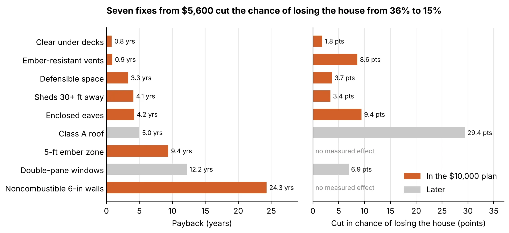
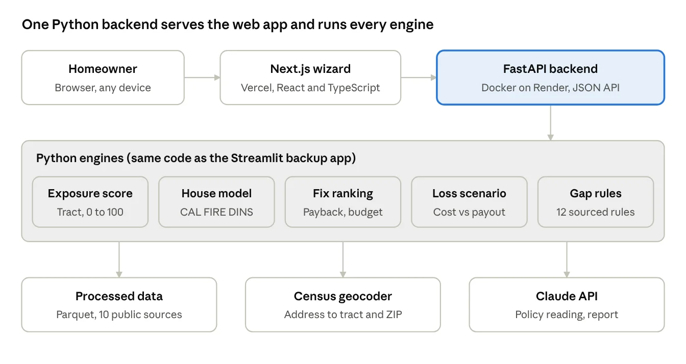

<figure class="demo">
<video class="demo-video" controls playsinline preload="none" poster="/projects/alwayshome/demo-poster.webp" width="1600" height="1000" aria-label="Demo of AlwaysHome: a sample Altadena homeowner goes through location, home, insurance, situation and plan, then moves the budget slider">
<source src="/projects/alwayshome/demo.mp4" type="video/mp4">
</video>
<figcaption>A 40 second run of the live app with a sample Altadena homeowner: location, home, insurance, situation, then a plan that rebuilds as the budget changes. Dollar amounts in the demo are placeholders.</figcaption>
</figure>
<h2>The result</h2>

For a sample Altadena homeowner (a 1952 wood-roof house, FAIR Plan only, $10,000 budget), the model estimates that seven fixes cut the chance of losing the house if fire reaches it from <strong>36% to 15%</strong>. That is an estimate from associations in two fires, not a measured effect of the fixes. Fix costs, discounts and the dollar figures in the demo are placeholders, not real quotes. The house-loss model behind that estimate reaches a cross-validated <strong>AUC of 0.80</strong> on the 4,525 homes with every feature recorded, out of <strong>22,071 CAL FIRE inspections</strong> from the January 2025 Eaton and Palisades fires.

<strong>How well it holds up.</strong> In those 4,525 homes, 20.6% were destroyed, so 0.80 is measured against that base rate. The model also uses the neighborhood (fire and ZIP). With whole neighborhoods held out in cross-validation, the house features alone reach an AUC of 0.68: the number that holds for an address the model has not seen.

<figure class="shot light-only">

<figcaption>Each fix ranked by payback, and how much it cuts the chance of losing the house. Orange fixes fit the $10,000 budget at placeholder costs.</figcaption>
</figure>
<h2>Where AI is, and where it is not</h2>

The AI does one job people find hard, reading an insurance policy, and is kept away from every number. Every cost, probability and payback comes from code and public data.

<table class="ptable">
<thead><tr><th>Step</th><th>How it is computed</th></tr></thead>
<tbody>
<tr><td>Wildfire exposure score</td><td>Deterministic. Equal-weighted index of four tract indicators for all 2,498 LA County census tracts</td></tr>
<tr><td>Chance of losing the house</td><td>Statistical model. Logistic regression on the 8 home answers plus a fire-by-ZIP effect, trained on CAL FIRE inspections</td></tr>
<tr><td>Fix ranking</td><td>Deterministic. Each fix is valued by switching one answer to its hardened value and re-scoring the home</td></tr>
<tr><td>Total-loss scenario and gaps</td><td>Deterministic. Rebuild, code upgrade, contents and rent compared with the policy limits; 12 gap rules, each with a source</td></tr>
<tr><td>Reading the declarations page</td><td>AI (Claude API). Returns 17 fields, each with the quote and page it came from</td></tr>
<tr><td>Plain-language report</td><td>AI, optional. Rewrites the template report and must keep every number exactly; if the call fails, the template is shown</td></tr>
</tbody>
</table>

Guardrails on the AI step: every quote is checked against the PDF's own text layer, impossible values are rejected, the homeowner confirms every value, the PDF is processed in memory and never stored, and AI calls are capped per visitor per hour.

<figure class="shot light-only">

<figcaption>The wizard runs on Vercel; the Python engines run behind a FastAPI backend on Render. Only the policy reader and the optional report call the Claude API.</figcaption>
</figure>
<h2>Decisions</h2>
<ul>
<li><strong>The AI never produces a number.</strong> We gave up a faster build (let a model estimate costs and savings) for figures we can trace to a source. Real contractor quotes and insurer discount filings are what would change the numbers.</li>
<li><strong>A logistic model, with a known leak removed.</strong> Inspectors mark "Unknown" far more often on destroyed homes, so "Unknown" gets its own term in training and is never used to predict; a homeowner's "I don't know" is scored as the average of known answers. Logistic on purpose: two fires is a small training base.</li>
<li><strong>Every network or AI step has a fallback.</strong> Three cached addresses and seven sample policies run with no network, so a live demo cannot dead-end.</li>
</ul>
<h2>My role</h2>

I led product and AI on a team of three. I built the homeowner experience end to end: the AI policy reader, the house-damage model, and the platform it runs on (FastAPI, Next.js, Vercel and Render, with 522 tests running on every push). David Ewenczyk built the data pipeline for LA County and the total-loss coverage model; Atharva Uplap built the wildfire exposure index and the insurance gap and recommendations engine.

<h2>The problem</h2>

Major insurers have stopped writing new policies in California, and more homeowners are pushed onto the FAIR Plan, the state's insurer of last resort. It costs more and covers less: fire only, no theft, water damage or liability. The state rewards specific fire-safety work with discounts, but nobody tells a homeowner which fixes matter most for their house, what each one costs, or what it would save. So they spend on the wrong upgrades or do nothing. Many also do not know how underinsured they are: after the 2025 fires, families found their limits did not cover rebuilding, code upgrades or two to three years of rent.

<h2>Who it is for, and who pays</h2>

<strong>The user is the homeowner:</strong> someone in LA County who was non-renewed by their insurer, now holds a FAIR Plan policy, and has a limited budget for upgrades. The core plan is free to them. <strong>The customers are businesses.</strong> A finished plan documents what has been hardened, what is still missing and where the coverage gaps are, which is worth money to:

<table class="ptable">
<thead><tr><th>Who</th><th>What they get</th><th>How it could earn</th></tr></thead>
<tbody>
<tr><td>Insurers re-entering California</td><td>Pre-screened, documented, mitigated homes that fit the state's Safer from Wildfires discounts</td><td>Referral fee per qualified lead</td></tr>
<tr><td>Brokers and agents</td><td>A ready report on the home's features, gaps and completed work</td><td>Subscription for client reports</td></tr>
<tr><td>Contractors</td><td>Homeowners who already know which job pays back first</td><td>Referral fee</td></tr>
<tr><td>Cities, counties, lenders</td><td>A neighborhood view of mitigation progress</td><td>Data and dashboard license</td></tr>
</tbody>
</table>

The revenue model is a proposal.

<h2>How it works</h2>

A five-step wizard, about two minutes end to end:

<ol>
<li><strong>Location.</strong> An address gives a wildfire exposure score (0 to 100), the mapped hazard zone, fires within 5 km and the ZIP's insurance market.</li>
<li><strong>Your home.</strong> Eight questions, the same features CAL FIRE inspectors record. "I don't know" is always allowed.</li>
<li><strong>Insurance.</strong> Upload the declarations page. AI fills in the form and shows the exact line it read for every value; the homeowner confirms.</li>
<li><strong>Your situation.</strong> The chance of losing the house, what a total loss would cost, what the policy pays, and the coverage gaps ranked by severity.</li>
<li><strong>Your plan.</strong> Fixes ranked by payback, a budget slider that rebuilds the plan live, risk before and after, and a report to take to a broker.</li>
</ol>
<h2>What the judges said, and what I changed</h2>

The judges called the idea truly impactful on society, and pressed on two questions: who exactly is the user and who pays, and where AI sits in the product. Both now lead this page and the README, as the "who pays" and "where AI is" sections above.

<h2>Scope and next steps</h2>
<ul>
<li>No user research: it was built in one day, without interviews with homeowners, brokers or insurers.</li>
<li>Los Angeles County only, total loss only, no partial claims. Not insurance advice and not an inspection.</li>
<li>Fix costs and insurance discounts are labelled assumptions; there is no public price per fix or premium per home.</li>
<li>The house-loss model shows associations from two fires, not causes. Where the data show no benefit, the app claims none.</li>
<li>Next: real fix prices and insurer discounts, photo and aerial pre-fill of the home questions, statewide coverage, and a referral path to insurers writing in that ZIP.</li>
</ul>
